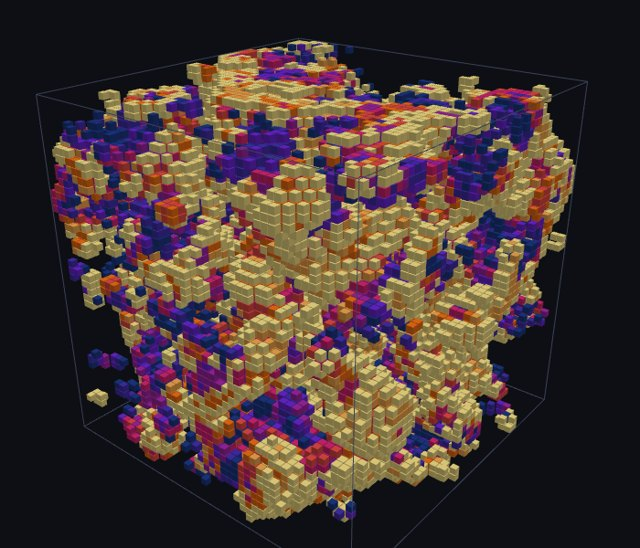
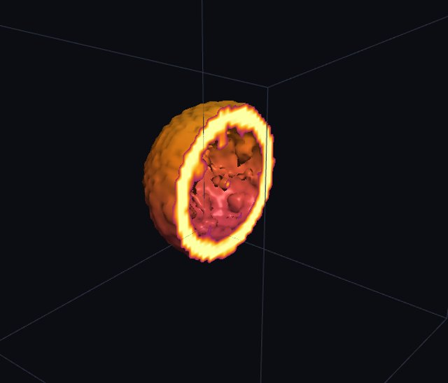

# 3D Automata Lab

Interactive 3D cellular automata and 3D Lenia, running entirely in the browser.

**Live demo:** https://ebhibhebhi.github.io/automata-lab/

| | |
|---|---|
|  |  |
| **[3D Cellular Automata](ca/)** | **[3D Lenia](lenia/)** |

## 3D Cellular Automata (`ca/`)

Discrete, outer-totalistic cellular automata on a cubic grid.

- Rules in `S/B/C/N` notation: survival counts / birth counts / number of states / neighbourhood (`M` = Moore, 26 neighbours; `VN` = von Neumann, 6).
- With more than 2 states, cells that fail to survive decay through `C-2` dying states before they can be reborn.
- Click-to-edit rule chips, presets (including Carter Bays' 3D Life rules 4555, 5766 and 5655), reproducible seeds, slicing, colour modes and a population chart.
- Neighbour counts use a separable 3×3×3 box sum, so a 64³ grid runs in real time.

## 3D Lenia (`lenia/`)

Continuous cellular automaton with continuous states, space and time.

Each step:

1. `U = K * A`: convolve the state with a radial shell kernel `K` (radius `R`, ring heights `β`).
2. `G(U) = 2·exp(-(U-μ)² / 2σ²) - 1`: the growth function.
3. `A ← clip(A + G(U)/T, 0, 1)`.

- The convolution is done with a 3D FFT in a Web Worker (`lenia/worker.js`), so the UI stays responsive.
- Rendering is GPU ray-marching over a 3D texture, as an iso-surface or a glowing volume, with a slice plane to see inside creatures.
- A live histogram of `U` is drawn under the growth curve, showing where cells sit relative to the growth peak.

The presets were found with a small automated parameter search. The 3D solitons it found are **metastable**: they hold together for hundreds of steps, then bud and fill space or fade away. Finding long-lived or moving 3D creatures is an open problem.

## Running locally

The Lenia page loads a Web Worker, which browsers block on `file://` URLs, so serve the folder:

```bash
python3 -m http.server 8000
# then open http://localhost:8000
```

No build step and no dependencies. Three.js is loaded from a CDN.

## Credits

- Lenia: Bert Wang-Chak Chan, [*Lenia: Biology of Artificial Life*](https://arxiv.org/abs/1812.05433) and [*Lenia and Expanded Universe*](https://arxiv.org/abs/2005.03742).
- 3D Life: Carter Bays, *Candidates for the Game of Life in Three Dimensions*, Complex Systems 1 (1987).
- Rendering: [three.js](https://threejs.org).

## License

MIT. See [LICENSE](LICENSE).
